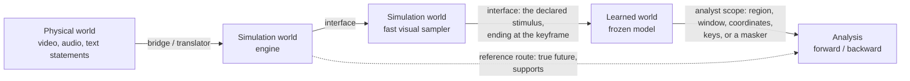

# Architecture

## One Architecture for Communication and Experiments

A **chain** is worlds joined by interfaces. A chain ending at an analyst is an
experiment. A two-world chain whose receiver acts on the message is communication.

## Worlds

A world implements `describe / open / fork / receive / apply / emit / close`:

- `describe` returns a `WorldCard` with identity, revision, kind (`physical`,
  `simulation`, `learned`), accepted and emitted channels, an optional intervention
  handle and stochasticity. A learned world's card carries a `LearnedContract`: it
  reads the whole stimulus, declares its prediction horizon (first step by default;
  longer rollouts are autoregressive), how it adapts the stimulus, and its precision.
- `open` prepares a context; `fork` makes an isolated branch.
- `receive` ingests an incoming message; `apply` applies an intervention at the handle
  world.
- `emit` returns an `Artifact`; `close` releases a handle.

`PhysicalScene` is the only world the framework ships. It holds the valid data
describing a real-world scene. With the default loader that data is parameters only,
and a custom loader adds recorded media. A physical scene can receive: incoming text
statements update its description.

## Artifacts and Scopes

An `Artifact` has named channels, each of one `Modality`:
- `video`, `audio` and `tensor` carry arrays;
- `text` carries `Statement`s with key, value, unit and kind, for quantities no other
  modality expresses (intent, laws, physical parameters, ranges).

An artifact records its source world revision, its parent artifact, the interface that
produced it, and the `Scope` applied to it.

A `Scope` selects channels, a time window, a spatial `Region`, tensor coordinates and
statement keys, and it can clip values. `Scope.apply` returns the scoped artifact with
the scope attached. `Scope.vector` reads only in-scope values: pixels outside a region
never enter the observation.

## Interfaces

An interface implements `describe` (an `InterfaceSpec` with identity, revision,
endpoints, kind and description) and `transmit`:

| Interface | Role |
|---|---|
| `ScopeInterface` | masking, clipping and selection; the analyst interface is one |
| `ParameterBridge` | a translator made only of parameters: renaming, unit scaling and constants |
| `ComposedInterface` | several interfaces in sequence, recorded as one declared interface |
| plugin translators | anything that needs a model: real2sim, video-to-parameters, learned maps |

## Chains and Measurement

`Chain` runs every counterfactual branch through all worlds on isolated forks. The
handle world applies the intervention, and every message is checked against the next
world's accepted channels. The analyst scope produces the observation vector.
`Chain.trace` returns every raw artifact and message of a branch, and `Chain.emitted`
returns one world's raw output.

A chain with learned worlds declares the `StimulusSpec`. Before a learned world
receives, the chain checks that every video channel holds exactly the stimulus frames
(the last one is the keyframe) and that no reference channel is present; it refuses
otherwise. `ReferenceRoute`s deliver the true future and engine-derived data straight
to the analyst. The analyst input is the last world's emission joined with the
reference routes and the context identity; `Chain.delivered` returns what a world
received.

A chain implements the measured-world protocol (`describe / open / fork / apply /
observe / close`). Paired runners, experiments, sequence tools and conformance
probes therefore apply to it unchanged. Its revision seals every world card, every
interface and the analyst scope, so any change to any layer is a different subject.

Samples from an effective simulator are draws indexed by seed. Under hard control
every branch of a context shares each of the context's draw seeds, so all branches
share their sampled appearance: only the intervention differs.

## Keyframe Alignment

The keyframe is structural (the last stimulus frame); whether its *content* agrees
across a context's branches is a declared policy, `KeyframeAlignment`: `free`,
`report` (default, with an optional warning threshold), `tolerance` or `identical`.
`Experiment` reads, through a tap with the chain's identity, the stimulus each branch
delivered to the first learned world and compares its keyframe with the reference
branch's keyframe under the same draw seed. The report's `keyframes` section holds
every difference, the flagged branches and the verdict; C22 re-derives it.
`keep_frames` also keeps chosen stimulus frames as a `KeyframeGallery` for viewers.

## Studies

A declaration seals one experiment. A `StudyLock` seals what several experiments
share so that their results may be compared: by default the stimulus, the
intervention design, the contexts, the observation time, the coupling and the
keyframe policy. Subjects, interfaces, maskers and methods vary. A declaration that
names a lock must match it, and carries it into the report (C21);
`compare_reports` lists, field by field, what agrees and what varies.

## Observation Masking

A masker is an analyst-side plugin inside a `MaskedScope`. It selects whole locations
(a `Grouping` maps observation dimensions to locations, e.g. the 1408 channels of one
patch token). It never projects: dimensionality reduction is a reserved stage of the
analysis method, after masking. Data-driven maskers
see a sweep at declared values disjoint from the evaluation's. The experiment sweeps
discovery, freezes the masker, assigns one instance per context, and repeats sweep and
assignment for each held-out stage after the laws are frozen.

## Analysis

`Declaration` fixes the reference, the labeled calibration branches, the queried
branches, the contexts and their roles, the conditions and the tasks. `Experiment`
runs the stages:
1. discovery (after its sweep and masker freeze, if masked), and the determinism check;
2. one freeze per task;
3. validation and confirmation against fixed controls;
4. regimes per condition value;
5. adjudication;
6. a sealed report with scoped claims.

A frozen law sees a `ContextView`: the context, the reference observation and the
labeled calibration responses of that context. Query outcomes appear only in
discovery, inside the `ResponseSet` used for fitting.

| Task | Law method | Controls |
|---|---|---|
| forward | `predict(view, intervention) -> response` | zero response; discovery mean response at the same intervention |
| backward | `recover(view, response) -> intervention values` | reference value; discovery mean queried value |

## What Is Not Established Automatically

- Conforming reports do not certify hidden-state isolation inside a plugin, the
  semantic adequacy of an alignment, or the independence of declared groups.
- A stable law in a learned world is not a physical mechanism. Physical correspondence
  is a separate, second-layer comparison.
- A digest detects change. It does not authenticate an author.
